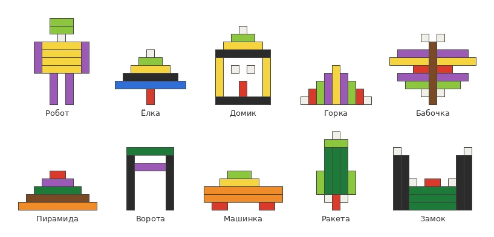
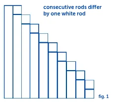

# Палочки Кюизенера: шаги занятий

Отдельная программа для игры с палочками. Открыли коробку, посмотрели, на каком мы шаге, и играем.
Основа — Teacher's Guide (`cuisenaire-teachers-guide.md`), адаптированная для 6 лет.

**Главный метод:** не объяснять, а задавать вопросы. Ребенок сам ищет, пробует и доказывает руками.
Взрослый наблюдает и спрашивает: «Почему эта?», «Как ты проверила?», «Есть еще способ?»

**Длительность:** 10–15 минут. К следующему шагу переходим, когда текущий перестал быть интересным
и выполнен критерий.

## Палочки в наборе

| Цвет | Длина | Буква | Сколько в наборе |
|---|:-:|:-:|:-:|
| белая | 1 | w | 22 |
| красная | 2 | r | 12 |
| светло-зеленая | 3 | g | 10 |
| фиолетовая | 4 | p | 6 |
| желтая | 5 | y | 4 |
| темно-зеленая | 6 | d | 4 |
| черная | 7 | k | 4 |
| коричневая | 8 | n | 4 |
| синяя | 9 | e | 4 |
| оранжевая | 10 | o | 4 |

---

## Шаг 1. Картинки из палочек

Палочки **лежат плашмя на столе**, из них, как из мозаики, выкладывается плоская картинка.
Можно строить и башни, заборы, колодцы — все, что захочется.

Картинки: `objects-from-rods.webp` (все 10 на одном листе), отдельные файлы в `rods-pictures/color/`,
контуры в `rods-pictures/outline/` и `rods-outlines-A4.pdf`.

### 1а. Копируем по цветной картинке

- Показать картинку на экране. Начать с того, что взрослый сам выкладывает одну картинку:
  «Смотри, что у меня получилось!» Потом: «Сделаешь такую же?»
- Ребенок копирует по цветам — это нормально. Тренирует внимание и знакомство с палочками.
- Потом свободно: «А что ты сама хочешь построить?»

Вопросы во время игры:
- «Есть палочки одинаковой длины? Как ты узнала?»
- «Ой, эта не подошла. Какую возьмешь вместо нее?»

Цель: ребенок сам замечает, что **палочки одного цвета всегда одной длины**.

### 1б. Контур (силуэт) — подбор по длине

- Цветную картинку убрать. Перед ребенком — серый контур, где видны только очертания палочек, без цветов.
- Ребенок прикладывает палочки: «длинновата», «коротка», «подошла!». Цвет больше не подсказывает —
  работает только длина.
- Контур можно:
  - распечатать из `rods-outlines-A4.pdf` (печать «Фактический размер» / 100%, проверить по синей
    палочке в ёлке);
  - обвести палочки карандашом на бумаге (взрослый или сам ребенок: выложила, обвела, убрала —
    готов контур для следующего раза).

### 1в. Строим вместе, без картинки

Картинку убрать, чтобы не подглядывала. Взрослый кладет палочку, ребенок следующую.
Задания, где следующая палочка однозначно определяется длиной:

- **«Закрой дырку».** Взрослый ставит две стены домика (или два столба ворот, две башни замка).
  Перекладина должна лечь точно от стены до стены. Ребенок подбирает длину сам.
- **«Каждый ряд короче».** Ёлка, пирамида, крыша домика: «Следующий ряд на одну белую короче с каждой
  стороны. Какая палочка?»
- **«Сделай вторую половину».** Взрослый строит одно крыло бабочки или одну башню, ребенок — такую же
  зеркально.
- **«Ступенька выше».** Горка: каждая следующая ступенька на одну белую выше.

Правила в картинках:

| Картинка | Правило длины |
|---|---|
| Ёлка, Пирамида, крыша Домика, нос Ракеты | каждый ряд короче на одну белую с каждой стороны |
| Горка | ступеньки на одну белую выше, потом ниже |
| Ворота, Замок | закрой дырку между столбами/башнями |
| Бабочка | второе крыло такое же, зеркально |
| Робот | две одинаковые руки, две одинаковые ноги |
| Машинка | ряды разной длины |

**Критерий:** ребенок подбирает палочку по контуру или в «закрой дырку» за 1–2 пробы, а не перебором.

---

## Шаг 2. «Одинаковые» и «вместе как одна»

- **«Разложи по цветам».** Высыпать все палочки, разложить по кучкам. «Что ты заметила про палочки
  в одной кучке?»
- **«Чудесный мешочек».** Несколько палочек в мешке. Взрослый показывает палочку, ребенок на ощупь
  ищет такую же.
- **«Найди одну вместо двух».** Взрослый кладет две красные подряд (как поезд), ребенок ищет одну
  палочку такой же длины — фиолетовую. Потом: белая + красная, две желтые и т. д.

**Критерий:** ребенок сам говорит «две красные — это как одна фиолетовая» и проверяет, приложив.

---

## Шаг 3. Лесенка (Fig. 1)

10 палочек, по одной каждого цвета, лежат рядом от белой до оранжевой, концы выровнены с одной стороны.

- **Сюжет:** «Мышке нужно залезть на шкаф. Давай построим ей лестницу». Строит сама, как получится.
  Если порядок перепутан: «Мышке удобно здесь шагать?»
- Вопросы: «Что ты видишь?», «На сколько каждая ступенька выше предыдущей?», «Как это проверить?»
- Если не догадается: «Мышка прыгает только на высоту белого кубика. Пройдет она всю лестницу?»
  Ребенок кладет белый кубик на каждую ступеньку — получается Fig. 1.
- **«Что пропало?»** Ребенок закрывает глаза, взрослый убирает одну ступеньку (или меняет две местами).
  Найти ошибку.

**Критерий:** ребенок сам собирает лесенку и объясняет: «каждая следующая на одну белую длиннее».

---

## Шаг 4. Числа для палочек

Не «сколько стоит каждая палочка» сразу, а игрой и по чуть-чуть.

- **«Шаги мышки».** Белый кубик — один шаг мышки. «Сколько шагов по красной палочке?» Ребенок
  выкладывает белые кубики вдоль палочки и считает. Сначала короткие (красная, светло-зеленая,
  фиолетовая, желтая), длинные — в другой день.
- **Карточки с цифрами.** Узнала, сколько шагов в палочке, — кладет рядом с этой ступенькой лесенки
  карточку с цифрой. В итоге лесенка подписана от 1 до 10.
- **«Дай мне три».** Взрослый называет число — ребенок дает палочку (светло-зеленую). Наоборот:
  взрослый показывает палочку — ребенок называет число.

Пока не делаем: «а если белая — это 2?» (подготовка к дробям, это позже).

**Критерий:** ребенок смотрит на палочку и сразу называет число; по лесенке говорит: «каждая следующая
на одну больше».

---

## Шаг 5. «Построй, как у меня» (Build what I have)

Упрощенная версия игры из руководства (стр. 2–3). Математики почти нет — игра на слова
«слева, справа, сверху, под, рядом, стоя, лежа». Хороша как разминка.

- У обоих одинаковый набор из 3–4 палочек. Между ними преграда (книжка).
- Взрослый строит фигуру и описывает словами: «Положи желтую палочку лежа. Справа от нее поставь
  фиолетовую стоя, чтобы получилась буква L». Ребенок строит по описанию, может задавать вопросы.
- Убрать преграду, сравнить. «Почему получилось по-разному? Какие слова помогли, какие запутали?»
- Поменяться ролями: ребенок описывает, взрослый строит.

---

## Шаг 6. Поезда — состав числа (Finding all the trains)

Руководство, стр. 4–6. «Поезд» — палочки, выложенные в ряд одна за другой.

- Положить светло-зеленую палочку. «Найди поезда из двух палочек такой же длины».
  Получится: красная + белая, белая + красная.
- Потом под фиолетовой, под желтой и дальше. Под палочкой выкладываются ряды — получается «коврик».
- **Только поезда из двух палочек** (в книге — из любого количества, для желтой их 16; это позже,
  отдельной игрой).
- Важно: «красная + белая» и «белая + красная» — разные поезда. Вопрос: «Чем они похожи? Чем отличаются?»

**Критерий:** под любой палочкой до желтой ребенок находит все поезда из двух палочек.

---

## Шаг 7. Записываем поезда числами

Руководство, стр. 5–6 (Connecting Numbers to the Rods).

- Взять поезд «красная + белая» под светло-зеленой. Взрослый пишет: **2 + 1 = 3**.
  «Почему это про наш поезд?» (Ребенок вспоминает: красная — 2, белая — 1, светло-зеленая — 3.)
- Для каждого поезда записать равенство: 2 + 1 = 3; 1 + 2 = 3.
- Вопрос: «Поезд перевернули — длина изменилась? А сумма?»

---

## Пока не трогаем (примерно с 8 лет)

Trains of one color (умножение), Rod pairs и Finding Equivalent Fractions (дроби), Exploring Ratio,
Perimeter.
