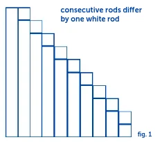
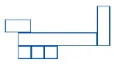
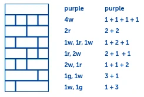
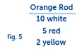
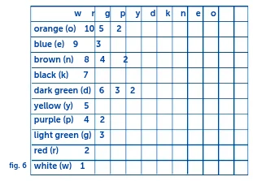
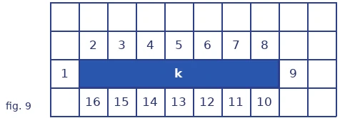
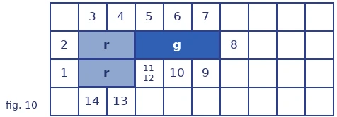
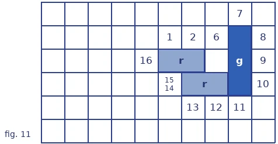
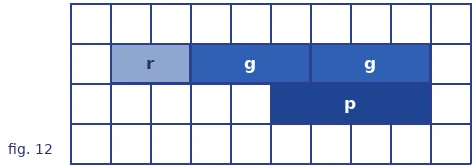

# Exploring Mathematics — Teacher's Guide

*Learning Resources · LER 7526 · ages 5+ · grades K+*

Cuisenaire® Rods are a collection of rectangular rods of 10 lengths and 10 colors, each color corresponding to a different length. The smallest rod, a white centimeter cube, is 1-centimeter long; the longest, the orange, is 10 centimeters.

Cuisenaire® Rods provide a continuous number model, rather than a discrete one. Thus they allow you to assign a value to one rod, and then to determine the values of the remaining 9 rods by using the relationships between the rods. For example, when the white rod is given a value of 1, the orange rod, which is ten times as long, has a value of 10; if the white rod is given a value of 2, the orange rod is 20; if the orange rod is 1, the white rod is 1/10.

Activities with Cuisenaire® Rods are appropriate for grades K through 8. They help students to explore whole numbers, fractions, measurement, ratio, area, perimeter, symmetry, congruence, three-dimensional geometry, patterns, and functions.

## Free exploration

Give students time to play with the rods before using them in directed lessons. Students are likely to make designs, create pictures, and build three-dimensionally. They will begin to notice rod attributes and relationships, for instance, that all blue rods are the same size, two reds equal a purple, or a purple is one white rod less than the yellow.

Provide guided exploration by asking students to lay one rod of each color flat on their desks to make a staircase. Have them discuss in their small groups what they notice and then report back to the class. Consecutive rods, for example, differ by the length of one white rod. Students often prove this by placing a white rod at the end of each rod (except the orange) in the staircase [Fig.1].



Ask students to discuss among themselves how much each rod is worth if the white rod is assigned the value of one. Show them that the white rod measures 1 centimeter on each edge. Have students share their answers and explain their reasoning. One group may report that the red rod is worth two "because it is twice as long as the white rod"; another may notice that "it takes two white rods to make a red rod, and one and one is two."

To reinforce that finding a value for each rod is based on the unit we choose, assign the white rod the value of two. When students are ready with their new rod values, again ask them to explain their reasoning. In this way, they clarify their thinking, and the relationships they discover are more likely to be remembered.

## Build what I have

This activity is appropriate for students in grades 2 through 8, working either with a partner or in small groups. Each group needs one set of rods. One student arranges rods in a particular way, keeping them hidden, and then gives verbal instructions so that the others reproduce the arrangement. This activity has several purposes — to increase students' familiarity with the rods, to introduce or reinforce mathematical vocabulary, and to improve students' communication and listening skills.

### Modeling the Activity

Choose 6 to 10 rods, each a different color or a combination of colors (1 yellow, 1 purple, 1 red, and 3 white). Have each student select the same set of rods from their supply. Then, using some or all of your rods, build a structure [Fig. 2], keeping it hidden from class.



Explain that they will try to reproduce your structure by following the directions you give. Ask students to set up barriers (books are helpful) that will keep their workspace private. Once students are ready, begin your directions, describing your structure in detail, using color, direction, shape, placement, etc. For example, you might say, "Place a yellow rod, flat on your desk, so that it is horizontal. Now put a purple rod to the right of it in the opposite direction so that the rods are perpendicular. Make them touch so that it looks like the letter L on its side." Allow students to ask questions at any time. Use correct mathematical language to enable students to learn vocabulary in context.

After all the directions have been given and everyone is ready, instruct students to remove the barriers and compare their structures. Give students time to discuss among themselves any differences they see and then report back to the class. Ask them why differences occurred. They may respond that they didn't understand some of the words you used ("perpendicular", "vertical"), or that some words ("on top", "over", "below") had several meanings. Ask students which words were helpful, and which were confusing.

### Building for Each Other

Students now do the same activity, working with a partner or in a small group. Once they've selected the rods they want to use, are positive each person has an identical set, and have put up barriers, one student creates a structure and describes it for the others to build. Remind them that the object is not to trick each other, but rather for everyone to build the same structure. When they're ready, students remove the barriers and compare their results, discussing what was said. Have them focus on which descriptions were helpful, which may have led to the differences, and the alternatives that might have been used. Repeat the exercise so that each student has a chance to give as well as to follow directions.

### Observing the Students

Circulate about the room, watching and listening to students. Notice which students are sure of directional words like right and left, and which students use specific words such as color or shape names. How do students deal with ambiguous words? Do they compare a part of their structure to something familiar — perhaps the roof of a house or an equal sign? Does the child asking another to place a rod in a vertical position, explain further with details such as, "Place it so its end is in the air" or "Lay it flat on your desk so it points to you"? What questions do they ask each other?

### Discussing the Activity

After students have had the chance to engage in this activity several times, ask students:

- In what ways was this activity easy? In what ways was it difficult?
- Was it easier to be the person doing the building or the person giving the directions? Why?
- Was it helpful to be able to ask questions as you build? Why?
- What mathematical words or phrases did you find most useful?

Most students will find this activity fun and challenging, so it is worth repeating from time to time. To vary it, allow no questions or only questions that can be answered yes or no. Start a class list of mathematical terms, adding additional words as they occur.

## Finding all the trains

In this activity, appropriate for grades 1 through 8, students build "trains" (rods lined up end-to-end) of rods equal to other rods. Working in pairs, they are asked to find all the possible combinations of rods that are the length of a particular rod in order to investigate addends, patterns, and permutations.

### Introducing the Activity

Each pair of students needs one set of rods. Begin by asking students to place a light green rod in front of them and to line up all the rods, like cars on a train, that equal it in length. There will only be four — light green, three whites, one white and one red, and one red and one white. Explain that when trains have the same rods but in a different order, they are considered to be different trains.

Students should work in pairs or in small groups to build and record all the trains equal to the purple rod, then all the trains equal to the yellow rod. Ask older students to look for patterns that can help determine how many trains are possible for any rod.

Younger students can record by coloring their solutions on a grid. Prepare recording sheets by marking rectangles on 1-centimeter grid paper — a 3-by-4 for the light green train, a 4-by-13 for the purple train, and a 5-by-20 for the yellow train.

Older students can create their own recording systems, and in a follow-up class discussion, share them. Some students may sketch each solution; others may use grid paper; others may make lists, using abbreviations of their own or the standard ones. Some may even use number sentences. [Fig. 3]



### Observing the Students

Watch and listen to students as they build. Which students build systematically? Which students rearrange each combination of a particular set of rods before trying other colors of rods? How do students divide the task? What patterns do they notice? Are students recording accurately? Young children often repeat patterns, not noticing or being concerned. Older children handle the challenge of finding all the different ways more easily. In either case, students are gaining experience using different addends for a particular number before linking this experience with numerical symbolism. It's easy to overlook some of the trains, especially with longer rods. If there are students who seem overly frustrated by the activity, don't push; however, give help to those who want it. Encourage them to rearrange a single set of rods, looking for an arrangement they haven't already recorded.

### Ideas for Discussion

Have students share their methods of approaching the problem, and if applicable, their recording systems as well. Students benefit both by listening to the explanations of others and by verbalizing their own approaches.

Ask student to describe patterns they noticed. For example, did students realize that twice as many trains were possible for the purple rod as for the light green rod? Did they then assume the yellow had 16 arrangements? Did students who suspected that doubling might be the pattern, test it for rods shorter than light green?

Once students share their recording systems, show them a recording scheme (Fig. 4) that mathematicians often use when investigating pattern. Point out that listing the rods in order of increasing size is done to make patterns easier to discern.

**Fig. 4**

| Rod         | Number of trains |
|-------------|:----------------:|
| white       | 1                |
| red         | 2                |
| light green | 4                |
| purple      | 8                |
| yellow      | 16               |
| dark green  |                  |
| black       |                  |
| brown       |                  |
| blue        |                  |
| orange      |                  |

### Connecting Numbers to the Rods

For younger students, writing number sentences for the trains they've built helps bring meaning to the symbolism used for addition and subtraction. Select one of the trains they recorded for the light green rod, such as one red rod and one white rod. Write 2 + 1 = 3 on the chalkboard or overhead. Ask students to discuss among themselves why this is a way to describe the red-white train. Some will remember their free exploration experiences, recalling that when the white rod had a value of 1, the red was worth 2, the light green 3, the purple 4, etc. Select another train and ask for the number sentence or equation that describes it. Continue until you have written a number sentence or equation for each train:

2 + 1 = 3; 1 + 2 = 3, and 1 + 1 + 1 = 3.

Next have students write number sentences or equations for each train they recorded, checking with a partner or others in their group. For students in grades 1 and 2, this is a way of relating addition to the appropriate notation. For students in all grades, it is a way to connect the notion of commutativity to something concrete — that is, just as the order of the rods doesn't affect the length of the train, the order of the numbers doesn't affect their total value.

## Trains of one color

For students in grades 3 through 6, this activity uses the rods to investigate multiplication. Students work together to find the different ways each rod can be made by using other rods of only one color. In so doing, they begin to explore multiples and prime numbers.

### The Investigation

Give each pair of students one set of Cuisenaire® Rods. Model the activity with the orange rod. Build in a systematic way, beginning with the white rod and moving on to the next longest rod. Approaching problems systematically will not only help children keep track of where they are, but will help them detect patterns more easily. After all the trains have been built, show students that to record them, they can simply name the rod they're trying to match and list the ways they find. [Fig. 5] Or, set up a chart such as this. [Fig. 6]





Have students continue to find all the ways to make trains of one color equal to each of the nine remaining rods and to record their solutions.

### Ideas for Discussion

When students are ready, have them share their observations in a whole class discussion. Typically students notice:

"Every rod can be made with white rods."

"Some rods can only be made with white rods."

"Every other rod in the staircase can be made by using two rods of the same color."

"Only two of the rods can be made by using three rods of the same color."

Ask students to discuss each of the following questions:

- Why can every other rod be made with two rods of one color? (These rods are equal to an even number of units, representing the numbers 2, 4, 6, 8, and 10; and they are evenly divisible by 2.)
- Which rods can only be made with white rods? Why?

(These rods — the white, red, light green, yellow, and black — represent the prime numbers 1, 2, 3, 5, and 7. Except for 1, they have no factors except themselves and 1; therefore, only the white rods, which represent 1, can be used to build them.)

*Note: Students can investigate numbers larger than 10 by taping together combinations of two or more rods. An "orange-white" rod, for example, made from one white rod and one orange rod, is equal to 11; an "orange-red" rod, created from a red rod and an orange rod, is equal to 12; and an "orange-orange-white", a combination of three rods, is worth 21.*

## Rod pairs – a fraction investigation

For students in grades 3 through 8, this activity uses the rods to develop the meaning of a fraction. Fractions indicate the relationship of parts to a whole rather than actual sizes. What, for example, makes something one-half or one-fourth or two-thirds of something else? In this activity, partners work together to find the relationships between pairs of rods, first looking for rods that are half as long as other rods.

### Introducing the Activity

Begin by asking students to find a rod half the length of the orange rod and to explain their thinking. Typically, students will find that 2 yellow rods equal 1 orange rod, so one of the rods would be just half as long.

Show students that this fact can be recorded in either of two ways:
`<o> = 2y` or `y = 1/2<o>`.

Ask them why this makes sense. These are explanations you may hear:

"They both mean the same thing."

"The first one means that it takes two yellow rods to equal an orange rod."

"The second one means that a yellow rod is one-half the size of the orange rod."

Now ask students to find all the other pairs of rods in which one rod is half the other, and to record their findings in the two ways shown. Check to see that they understand the assignment and the method of recording; then ask them to continue the exploration by finding all the pairs of rods in which one rod is 1/3 of the other, 1/4, etc., up to 1/10. Remind them to record all of the relationships they find.

### Discussing the Activity

When students have completed the activity, have them share their findings, and make a list where all can see. Begin by listing relationships showing halves. Then ask the following questions:

- How do you know the list is complete?
- Why is the yellow rod the longest rod you found that is half of another rod?
- Do all rods have one-half rods?
- By combining rods, could you make a length of which dark green would be half? (Orange and red).
- Could you make lengths of which each rod longer than dark green could be half?
- Could you make lengths of which no rods could be half?

Solving these questions may lead students to the discovery that although every rod (or number) is half of some other rod, not every rod has a rod equal to half of it. These rods represent the odd numbers that cannot be divided by 2 and have a whole number answer. (Only those rods that represent even numbers will have halves.)

List and discuss the remaining relationships found by the students. It's important that they verbalize the idea that if it takes three of one color rod to make another rod, the first is one-third of the second; that if it takes four of one color rod to make another, the first is one-fourth of the second, etc. In discussing the fractional notation of 1/2, 1/3, 1/4, etc., make sure students note that the bottom number, or denominator, of the fraction indicates how many parts are required to make the whole, or that the whole has been divided evenly into this many parts

### An Extension for More Experienced Students

This activity involves fractions with numerators other than 1. It presents a greater challenge to students, as they must figure the number of single units in each rod in the pair before they can determine the relationship of the rods to each other.

Begin by asking students to describe the relationship of the red rod to the light green rod and to explain their reasoning. One student may answer, "The red rod is 2/3 of the light green rod, because it takes three white rods to equal the green rod, and the red rod is equal to two of the white rods"; another, that, "A white rod is 1/3 of the light green rod, and the red rod is equal to two white rods. So the red rod is equal to 2/3."

Ask students in groups to find the fractional relationship between each of the following pairs and to be prepared to explain their thinking: red and blue; purple and orange; purple and yellow; dark green and orange.

Again, have students share their answers and how they found them in order to give them a chance to reflect on what they did.

## Finding Equivalent Fractions

In this activity, appropriate for grades 3 through 8, students encounter equivalent fractions, including both improper fractions and mixed numbers. They choose a rod, build all the one-color trains they can for that rod, then find all the names for the rods they use. This enables them to learn that different fractional names can represent the same amount of the whole. The exploration becomes more challenging when students, taking each rod in turn, give it a value of one, and determine all the fractional names for each of the other rods.

### Introducing Equivalence

Begin by asking students to build all of the possible one-color trains that equal the orange rod. They'll be able to build a train of 2 yellows, a train of 5 reds, and another train of 10 whites. Then ask them to list all the ways to write the value of each of the rods they used — the white, the red, the yellow, the orange — if the orange rod is given a value of one. [Fig. 7]

**Fig. 7**

```
IF  o = 1

    w = 1/10
    r = 1/5 or 2/10
    y = 1/2 or 5/10
    o = 1 or 5/5 or 10/10
```

Some students may not realize that the red rod can have two names — 1/5 and 2/10. Draw their attention to the fact that two white rods exactly equal one red rod. Since one white rod is 1/10 and two white rods 2/10, the red rod is also 2/10.

Assign a value of 1 to the blue rod. Ask students to build all the one-color trains that equal the blue rod, and then to find the fractional names for the rods they use. Have them investigate each of the other rods in the same way.

When students are ready, have groups share their results for a particular set of rods and explain the reasoning they used in naming each rod. Ask them why they were unable to find more than one name for the black, yellow, light green, and red rods. (These are rods that can only be built with the white rods.)

### Finding All the Names

Model the activity with the brown rod having a value of 1. Begin with the white rod, as other rods may need to be compared with it before their values can be determined. Once students have agreed that the white rod is 1/8 and can explain why, ask about the red rod. If students offer just one of these explanations — "The red rod is 1/4 because it is the length of 2 whites" or "The red rod is 1/4 because it takes four of them to make a brown rod" — offer the other. Next, figure the value of the light green rod, which does not evenly divide the brown rod. As students did in the rod pairs activity, they will need to use the white rod to prove light green equals 3/8. Continue, finding and discussing all the values for each rod, recording on the chalkboard or overhead. [Fig. 8]

**Fig. 8**

```
IF the brown rod = 1,

w = 1/8                  y = 5/8                       e = 9/8 or 1 1/8
r = 2/8 or 1/4           d = 6/8 or 3/4                o = 10/8 or 1 2/8 or 1 1/4
g = 3/8                  k = 7/8
p = 4/8 or 2/4 or 1/2    n = 1 or 8/8 or 4/4 or 2/2
```

A new situation comes up when naming the blue rod, since it is longer than the brown. Not all students will see that it has two names — 9/8 since it is as long as 9 white rods, and 1 1/8 since it is as long as 1 brown rod and 1 white rod. This is a good time to talk about improper fractions and mixed numbers.

Once students seem to understand how to proceed, ask them to find all the fraction names for each rod when the blue rod is assigned the value of 1. Have them record their findings and be prepared to explain them. Although you may want to remind students to compare each new rod to all the rods for which they've already found names, don't be concerned if students still overlook some. The emphasis should be on exploration, not on getting all the correct answers.

Continue with the black rod, the orange rod, etc., until all of the rods are done over a period of time.

## Exploring Ratio

Students need many experiences involving ratio and proportional reasoning before being introduced to the symbolism that denotes ratio. In these explorations, students use the orange rod measurement of an object and the relationships between rods to calculate, without measuring, the length of the object in rods other than the orange one. The first activity is appropriate for first and second graders. As students watch, measure an object with orange rods, then ask them to find how many yellow rods it would take to measure the same object. The second activity, appropriate for students in grades 3 to 8, extends the first by having students find the length of the object using other rods as well as the yellow.

### How Many Yellows?

Find an object that measures between 9 and 12 orange rods in length — a windowsill, chalk tray, bookcase, etc. Once you've chosen the object, ask students to predict how many orange rods it would take to measure its length. Have them discuss their prediction with a partner before sharing with the class. List the predictions on the chalkboard; then measure the object as the students watch.

Next, pose this problem for pairs of students to consider, "How many yellow rods would it take to measure the same object?" Give each pair of students one orange rod and one yellow rod, and tell them that they are to solve the problem without actually measuring the object with the yellow rod. When they have an answer, they should record it and explain in writing why they think their answer is correct.

### Observing the Students

Observe student's approaches to the problem. Some may know immediately how to get started; others will require more time to think. If partners have no idea how to proceed, ask them what they notice about the length of the orange and yellow rods. If necessary, have them measure the orange rod with the yellow rod, and ask if this information helps. Some students may measure the object in spite of your directions not to.

In listening to children as they work, you may hear: "It takes two yellows to make an orange"; "It's going to be more yellows" and "It's going to be two times as many yellows, so we have to add (or multiply)."

When all students are ready, have them take turns reading their explanations aloud to the class. (Less experienced students may have difficulty explaining themselves clearly in writing. However, it's a skill worth developing; so bear with early attempts. Give students guidance in learning to include all pertinent information in their explanations. Give them frequent opportunities to explain things orally. Point out that written explanations are like spoken explanations written down.) After all partners have reported their answers, measure the object with yellow rods.

### Variation for Older Students

Ask students to help you locate an object that is about 12 orange rods long, measuring each object as it is suggested. Once found, ask partners to decide how long that object would be in yellow rods.

Typically, students offer the following explanations:

"Two yellow rods fit on one orange, so we did 2 times 12 and got 24."

"We multiplied 12 times 2, 12 orange rods times 2; and we got 24."

"There are 12 orange, and 2 yellow make an orange, so we counted by two's. We think the answer is 24."

After they have shared their thinking, assign partners the task of figuring out the length of the object in white rods, in red rods, and then in dark green rods, without measuring it. Each pair of students needs one set of rods and one recording sheet. Have them record their explanations in writing. Ask students who finish before the others to find the length in blue rods, black rods, etc.

When all students are ready, have them read aloud what they have written, discussing any disagreements that may arise.

Encourage them to listen carefully to each other. Acknowledge that trying to follow someone else's reasoning is often difficult, but trying to do it will help them deepen their understanding.

## Perimeter with Cuisenaire Rods

In the following investigation with Cuisenaire® Rods, appropriate for grades 3 through 8, students explore perimeter, make comparisons, and use spatial reasoning. Students' prior experience dictates where to begin and how to proceed. Each pair of students will need one set of 74 rods and a supply of one-centimeter grid paper.

### Introducing Perimeter

Explain to students that perimeter is the distance around something, and demonstrate how to find the perimeter of a Cuisenaire rod. Do this by placing a rod of any color on centimeter grid paper, then either trace around it or make a sketch. Remove the rod and count aloud the number of units along the outline [Fig. 9].



Have students find the perimeter of several other rods, verifying their results with each other.

Now make a shape [Fig. 10] with two red rods and one light green rod, and model finding its perimeter. (Place the rods in such a way that the outlined shape could be cut out and remain in one piece.)



Rearrange the same three rods into a different shape [Fig. 11]. Direct students to build the same shape, to trace or draw it, and to find its perimeter.



Ask students to make still another arrangement with these rods and to find its perimeter. (Remind them that the shape they make must be one which can be cut from paper with the paper staying in one piece.) Students are sometimes surprised that shapes, though different, can have the same perimeter.

### Making Shapes

Once students seem comfortable finding perimeters, ask them to work in small groups to investigate the following problem. "Use one red rod, two light green rods, and one purple rod to make at least ten different shapes, finding the perimeter of each one. Record each shape and its perimeter on grid paper. Keep track of the methods you use to make the different shapes, and be ready to discuss this as well as any patterns you notice."

Encourage students to discuss the activity as they work through it to help prepare them for the class discussion to follow. Allow students at least one class period of exploration time.

### Observing the Students

Circulate among students, watching and listening as they solve the problem. Doing this allows you to assess both their knowledge of perimeter and their ability to solve problems. You can see which students use previously learned information, which are able to extend the ideas of the other members of their group, and which are "making connections" as they rearrange the rods. You may, for example, learn which students are able to generalize — realizing that while the areas of the shapes are remaining constant, different shapes may or may not have the same perimeter. Some students may begin to hypothesize about why this is so. Observing and listening will give you ideas for summarizing the activity in the follow-up class discussion.

Give help only if you are asked. If a group presents you with a dilemma, respond by asking them to explain what they've already done. Reflecting on what they've done may clarify their thinking and allow them to resolve their dilemma for themselves.

### Discussing the Activity

When students have had sufficient exploration time, ask volunteers to share how they created each new shape and figured the perimeters. Did they move from one shape to another in a systematic fashion, perhaps moving only one rod, or did they rearrange all the rods each time they made a shape?

Ask students to discuss the following questions in their small groups and to be ready to report back to the class:

- How many different perimeters did you find using these four rods? How might you go about checking that you have all the possible perimeters?
- What is the least possible perimeter? Is there more than one shape with this perimeter?
- What is the greatest possible perimeter? Is there more than one shape with this perimeter?
- Did you find more efficient ways to figure the perimeter than by counting every unit?

Not all students will have discovered that the possible perimeters range from 14 centimeters to 26 centimeters and that there's more than one way to create both the smallest and the largest perimeters. A class discussion provides them an opportunity to re-examine their observations. The following are typical of the responses students give.

"We found 14, 16, 18, and 26, so we figured 22 and 24 must be possible. We tried them and they were."

"I can tell that two shapes have the same perimeter by counting sides that touch. If one has more touching than the other, the perimeters have to be different."

"We realized that if we slid the purple rod to the left, the perimeter didn't change." [Fig. 12]



Following the class discussion, have groups cut out and post their different shapes on the bulletin board or chalkboard. Choose one group to start, and direct other groups to add only shapes that have not already been posted. This gives students an opportunity to compare, match, and sort. At the same time, it provides them with more time to reflect on the results. The posted shapes can also lead to these further investigations.

- How many different shapes have a perimeter of 18 (or 20, 22, 24, etc.)?
- How are the shapes with the same perimeter the same or different? (This question allows students to consider ideas of symmetry, similarity, congruence, rotations, and flips.)
- How do the shapes with a perimeter of 14 differ from those with a perimeter of 26? (Students may realize that the shapes with the smaller perimeter are more compact, while those with larger perimeters are more stretched out.) How would you arrange the rods when you want a figure with a small perimeter?

This activity can be repeated several times throughout the school year, changing the colors and number of rods used.

### A Spatial Reasoning Extension

Ask students to pick one of the posted shapes and to try to fill it with a different set of rods. Can it be done? Can it be done with still another set? And another? This shape [Fig. 13] can be filled with a set of 12 white rods, or a set of 6 red rods, or with 2 light green and 3 red rods.


Such spatial reasoning gives students practice in the kind of everyday skills used to determine that a 6-inch bowl is just right for storing the leftover pretzels, that a stack of dishes will fit a particular shelf, and that the parking space is too small for the car.

### Perimeter Puzzles

Since each puzzle has many solutions, this activity provides meaningful practice with perimeter in a problem-solving context. Post the puzzles or distribute copies to each student. Ask students to look for several solutions to each one, recording the solutions they find and noting discoveries to share during a class discussion.

1. Use 2 red rods and 1 purple rod to make a shape with a perimeter of 14 units.
2. Use 1 red, 1 green, and 2 purple rods to make a shape with a perimeter of 24 units.
3. Use 2 red, 2 green, and 1 purple rod to make a shape with a perimeter of 30 units.

Students can work on these puzzles individually or in small groups. Keep a class chart [Fig. 14], which students sign as they complete a puzzle, to encourage them to find other students to discuss the puzzles with them.

**Fig. 14** — *Sign your name under the puzzle(s) you've tried.*

| Puzzle 1 | Puzzle 2 | Puzzle 3 |
|----------|----------|----------|
|          |          |          |
|          |          |          |

Have students make up their own puzzles for others to solve. Ask them to use five or fewer rods and to specify the numbers and colors of rods to be used, as well as the perimeter to be made. This makes the task manageable for both the creator and the user. Ask them to have a classmate check their puzzle before adding it to the class set.

### Additional Puzzles

The following puzzles deal with both area and perimeter and will likely be more difficult for students to solve.

1. Make a shape with an area of 26 square units and a perimeter of 26 units, using 2 red rods, 2 purple rods, 1 green rod, 1 yellow rod, and 1 dark green rod. Use the same 7 rods to make an 8-sided figure with an area of 26 square units and a perimeter of 26 units.
2. Make a shape with 8 sides, a perimeter of 32 units, and an area of 34 square units, using 1 black rod, 1 dark green rod, 1 yellow rod, 2 purple rods, 2 green rods, and 1 red rod. Use the same 8 rods to create a figure with 12 sides, a perimeter of 40 units, and an area of 34 square units.
3. Make a shape with a perimeter of 28 units and an area of 25 square units. Use no rods shorter than a light green rod or longer than a yellow rod.
4. Make an 8-sided figure with an area of 35 square units and a perimeter of 42 units. Use exactly 8 rods, none shorter than a red rod or longer than a dark green rod.

As before, have interested students create a class set of their own area and perimeter puzzles.

*Note: For less experienced students, you may need to demonstrate how to find the area of a shape. Choose any three rods, make a shape that will remain in one piece if cut out, trace around the shape, remove the rods, and count the squares. Be sure to point out the difference between finding area and finding perimeter.*
