# Numicon at Home — Next Steps Activity Book

*Oxford University Press, 2021 · Written by Louise Pennington. Digital copy of the Activity Book, kept close to the original text. Pictures are simplified schemes; character pictures are left out.*

> **Who does each step:** the label after each step number is the one from the book (*Player 1*, *Player 2*, *Both players*). The note after it (adult / child) shows who is pictured doing the step.
>
> **Key activity — repeat often** at the end of an activity = marked with a star in the book: especially important to repeat, because it builds key skills.

---

## Contents

- [Welcome to your Next Steps Kit](#welcome-to-your-next-steps-kit)
  - [How to use this book](#how-to-use-this-book) · [All you need](#all-you-need) · [Bonus activities!](#bonus-activities) · [Enjoy](#enjoy)
- [Getting started](#getting-started)
  - [Get to know Numicon Shapes 1–10](#get-to-know-numicon-shapes-110)
  - [Numicon Shapes to 20](#numicon-shapes-to-20)
- [Playing with patterns](#playing-with-patterns)
  - [Continue the pattern](#continue-the-pattern)
  - [Growing and shrinking patterns](#growing-and-shrinking-patterns)
- [Comparing and counting](#comparing-and-counting)
  - [Comparing sets by counting how many](#comparing-sets-by-counting-how-many)
  - [Finding how many without counting!](#finding-how-many-without-counting)
  - [More, less and equal](#more-less-and-equal)
- [Numbers to 30](#numbers-to-30)
  - [Building numbers to 30](#building-numbers-to-30)
- [Odd and even](#odd-and-even)
  - [Is it odd or even?](#is-it-odd-or-even)
  - [Odd and even detectives](#odd-and-even-detectives)
- [Adding and subtracting](#adding-and-subtracting)
  - [Pairs to and within 10](#pairs-to-and-within-10)
  - [What's my number?](#whats-my-number)
  - [10 more/10 less](#10-more10-less)
  - [Pairs to 20](#pairs-to-20)
  - [Race to 40](#race-to-40)
  - [Spin to add or take away](#spin-to-add-or-take-away)
- [Doubles and halves](#doubles-and-halves)
  - [Spin a double or half!](#spin-a-double-or-half)
- [Numbers to 100](#numbers-to-100)
  - [Building numbers to 100](#building-numbers-to-100)
  - [Partitioning](#partitioning)
- [Multiplying](#multiplying)
  - [Counting in twos, fives and tens](#counting-in-twos-fives-and-tens)
  - [Lots of](#lots-of)
- [Dividing](#dividing)
  - [How many __ in __?](#how-many-__-in-__)
  - [Dividing by 2, 5 and 10](#dividing-by-2-5-and-10)
- [Fractions](#fractions)
  - [Fold the Shape](#fold-the-shape)
  - [Build a whole!](#build-a-whole)
- [Answers](#answers)
- [What next?](#what-next)

---

## Welcome to your Next Steps Kit

We hope you and your child enjoy using this Numicon at Home Kit. The activities and apparatus have been carefully designed to develop your child's maths understanding, to support you both and give you hours of fun.

### How to use this book

**Work through the activities in order**
Take it slowly. Allow plenty of time for each activity, working through them gradually and in order. It's important that your child becomes confident before moving on, so try not to rush onto the next stage too quickly.

**Play and repeat**
All the activities in this book are meant to be done many times. The more often you can do them, the easier it will be for your child to absorb the ideas and make connections. Some activities are particularly important to repeat, because they build key skills that will help your child in class. We've marked these activities with a star.

**Better together**
The activities and games are for you to do together. The adult and the child pictures will show you who is doing each step. Most of the time the adult goes first, so that your child can see what they will need to do. They can carry on or take over whenever they are ready.

**Keep talking**
The key to learning maths is to talk about it. As you both do the activities, talk about what you are doing and try to explain what you are thinking to each other. At the top of each page you'll see the Conversation Cat with a list of words for you to use. Don't worry if you can't use them all. Start with the words your child is familiar with and see what words you can bring in each time you play.

> *Example —* **Words to use:** copy, pattern, next, before, after, colour names

**My goal**
At the bottom of each activity you'll see the Brainy Bunny with 'My goal'. This shows you the purpose of the activity and celebrates what your child is learning to do. Reaching this goal won't happen immediately and the activities are meant to be played many times. Focus on enjoying each activity together and celebrate any steps in learning along the way.

> *Example —* **My goal:** I will learn to recognize the patterns of all the Numicon Shapes.

**Guidance**
Boxes like this appear at the start of some activities. They include advice and useful tips to help you.

> *Example —* **Guidance:** Dividing by 2 is the same as finding a half.

### All you need

You'll find a list of what you need for the activities at the top of each page. Here's a quick guide to the apparatus in your box. On the cut-out cards you will find question cards, numeral cards (0 to 100), place value frames, a number track (1 to 100) and different overlays you can put on your spinner.

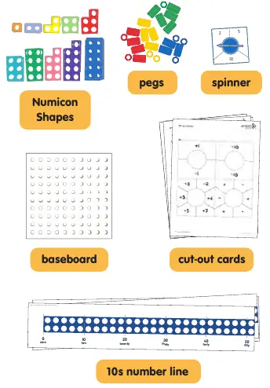

### Bonus activities!

*For more online, see the back cover!*

We've provided extra activities, resources and support for you online, on Oxford Owl for Home. This includes videos, activities you can download and other resources, such as blank spinner overlays for making your own games and challenges. Just use the link or the QR code at the back of your book.

### Enjoy

Feel free to let your child explore and play with the resources in this kit, even if what they do doesn't look like maths. If your child is enjoying playing with the Numicon resources, then you can be sure they are learning something valuable.

[↑ Contents](#contents)

---

## Getting started

### Get to know Numicon Shapes 1–10

**Words to use:** staircase, pattern, order, next, shape, odd, even, number, colour, cool, warm

> **Guidance:** Even number Shapes are all regular, but odd number Shapes have a bit that 'sticks up'. Odd number Shapes are warm colours, such as red and orange, while even number Shapes are cool colours, such as blue and green.

**You need:** Numicon Shapes, cut-out numeral cards 1–10.

**1.** *Both players* — Lay out the Numicon Shapes in order like this. This is the Numicon 'staircase' pattern. Match each Shape with its numeral card.

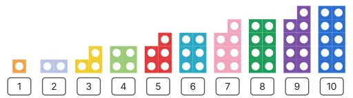

**2.** *Both players* — Move the numeral cards to one side. Move the odd Shapes down a bit and the even Shapes up.

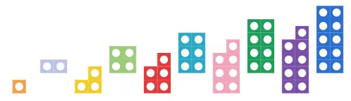

Ask:
- **Adult:** "Can you describe the odd number Shapes and then the even number Shapes?"
- **Child:** "Odd number Shapes have a bit that sticks up. They are 1, 3, 5, 7 and 9."

**3.** *Both players* — Stack the even Shapes on top of each other and then stack the odd Shapes.

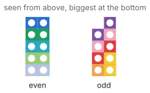

**4.** *Player 2 (child)* — Take a Shape from each stack in turn. Match the even Shapes to the even numeral cards and the odd Shapes to the odd numeral cards.

> 🐰 **My goal:** I will get to know the Numicon staircase and the odd and even Shapes.

[↑ Contents](#contents)

### Numicon Shapes to 20

**Words to use:** staircase, pattern, order, next, shape, odd, even, number, colour, cool, warm, teen number names

> **Guidance:** Once you've built the Shapes from 11 to 20 in Step 3, talk about the patterns and say what you see. For example, '15 is a 10-shape and a 5-shape'.

**You need:** Numicon Shapes, cut-out numeral cards 1–20.

**1.** *Player 1 (adult)* — Put each Shape in order in the staircase pattern. Label with numeral cards 1–10.


**2.** *Player 2 (child)* — Add what comes next. Put a 1-shape on top of another 10-shape at the end of the staircase.

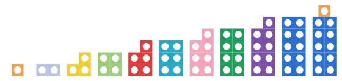

**3.** *Both players* — Take it in turns to add the next number. As you make the number, say the number name and label it with a numeral card. Continue until you get to 20.

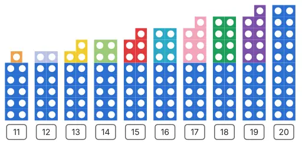

**4.** *Both players* — Tidy away the staircase pattern. Take turns to say a number between 10 and 20. The other player must build that number with Numicon Shapes.

> 🐰 **My goal:** I will know how to build numbers to 20 with Numicon Shapes in the staircase pattern, say the name of each number and label it.

> 💡 **Try this!** Repeat until you can build and name numbers to 20 quickly and easily.

[↑ Contents](#contents)

---

## Playing with patterns

### Continue the pattern

**Words to use:** continue, match, pattern, the same, next, direction, predict

> **Guidance:** Talk about the patterns. Copy them, predict what comes next and then continue the pattern.

**You need:** Pegs, baseboard, paper, coloured pencils.

**1.** *Player 1 (adult)* — Make a pattern like this with pegs on the baseboard.

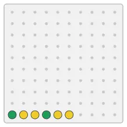

**2.** *Player 2 (child)* — Continue the pattern.

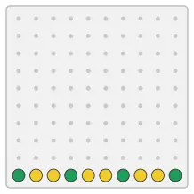

**3.** Ask:
- **Adult:** "Can you describe the pattern?"
- **Child:** "The pattern goes along the board, 1 green, then 2 yellow, 1 green, then 2 yellow."

**4.** *Both players* — Play again, but this time Player 2 starts. Keep taking turns and play this often. Try drawing or writing down your patterns.
- `BRBBRBRBBR`
- **Child:** "I have written down my pattern using B for blue and R for red."

> 🐰 **My goal:** I will be able to spot patterns and predict what comes next!

> 💡 **Try this!** Try making different peg patterns in different directions, such as up, down, across the board or diagonally.

> **Key activity — repeat often** (marked with a star in the book).

[↑ Contents](#contents)

### Growing and shrinking patterns

**Words to use:** copy, growing, shrinking, too many, too few, enough, not enough, the same

> **Guidance:** Look at the colours and direction of each pattern. In this activity, the growing patterns get bigger, going up by the same number each time and the shrinking patterns get smaller, going down by the same number each time. The final pattern here grows and shrinks. When you invent your own patterns, you could also try using pegs.

**You need:** Numicon Shapes, baseboard.

**1.** *Player 1 (adult)* — Make this growing pattern with Numicon Shapes.

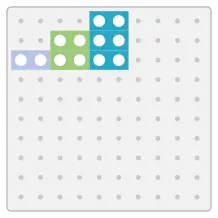

**2.** Ask:
- **Adult:** "Can you describe the pattern? Does it go up or down?"
- **Child:** "It's 2, 4 and then 6. It goes up in steps of 2, so it's a growing pattern."

**3.** *Player 2 (child)* — Copy and continue the pattern. Describe it.
- **Child:** "I need to add Shapes that go up in steps of 2, so I add an 8-shape and then a 10-shape."

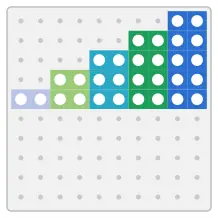

**4.** *Both players* — Play again, but now Player 2 starts. Try some patterns like the ones below. Continue your patterns across the table.

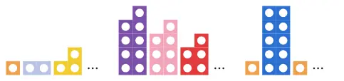

> 🐰 **My goal:** I will be able to copy, continue and build more complex patterns.

> 💡 **Try this!** Try to invent your own patterns.

*Answers: see [Answers](#answers).*

[↑ Contents](#contents)

---

## Comparing and counting

### Comparing sets by counting how many

**Words to use:** how many? more, fewer, the same, compare, check, count, total

> **Guidance:** We use 'more' and 'fewer' to talk about things we can count. In this activity, you make Numicon Shape patterns with the pegs. These match the patterns of holes in the Shapes. If you select the same number of pegs, talk about the amounts and the Numicon Shape patterns being 'the same'.

**You need:** Pegs, Numicon Shapes.

**1.** *Both players* — Pick up a handful of pegs each.
- **Adult:** "Who do you think has more?"
- **Child:** "I think I have more!"

**2.** *Both players* — Carefully count how many pegs you have. What is your total?
- **Adult:** "I have 7 pegs in total."
- **Child:** "I have 9 pegs."

**3.** *Both players* — Arrange your pegs into Numicon Shape patterns to compare and see who has more. Place a Numicon Shape next to your pegs to check the pattern.
- **Adult:** "I have fewer pegs."
- **Child:** "I have more pegs!"

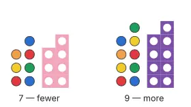

**4.** *Both players* — Repeat often with different numbers.

> 💡 **Try this!** Use two hands to pick up the pegs so that you can work with larger numbers!

> 🐰 **My goal:** I will know how to compare sets by counting.

> **Key activity — repeat often** (marked with a star in the book).

[↑ Contents](#contents)

### Finding how many without counting!

**Words to use:** estimate, how many? order, pattern, match

> **Guidance:** Start playing this activity with a small number of pegs. When your child is ready, gradually increase to playing with up to 20 pegs.

**You need:** Baseboard, pegs, Numicon Shapes.

**1.** *Player 1 (adult)* — Close your eyes while Player 2 puts some pegs on the baseboard.

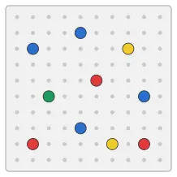

**2.** *Player 1 (adult)* — Open your eyes and look at the pegs for a few seconds. Don't try to count them. Estimate how many.
- **Adult:** "I estimate 10."

**3.** *Player 1 (adult)* — Order the pegs into a Numicon Shape pattern and then check against the Numicon Shape.

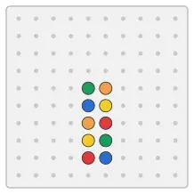

**4.** *Both players* — How close was the estimate? Swap roles and play again.

> 🐰 **My goal:** I will practise estimating skills without having to count!

[↑ Contents](#contents)

### More, less and equal

**Words to use:** more, less/fewer, equal, the same, match, pattern

> **Guidance:** It helps to move pegs one at a time from the top of the larger number to the smaller number to make the sets equal. Note how many pegs you moved.

**You need:** Pegs, baseboard.

**1.** *Player 1 (adult)* — Make one pile of 5 pegs and another pile of 7 pegs.

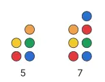

**2.** *Both players* — Choose a pile each and use the pegs to make a Numicon pattern. Make your patterns next to each other.

Ask:
- **Adult:** "Can you move pegs so that both sets have an equal number of pegs?"

**3.** *Player 2 (child)* — Move 1 peg or more to make the two patterns equal.
- **Child:** "The 5-pattern has fewer pegs than the 7-pattern. I can move the red peg from the 7 to the 5 to make them the same."

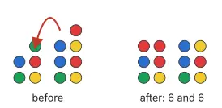

**4.** *Both players* — Swap roles and repeat with these numbers of pegs: 4 and 6; 7 and 11; 2 and 8.

> 🐰 **My goal:** I will compare sets and be able to make them equal.

> 💡 **Try this!** Try the activity again with any two numbers that have a difference of 2, 4, 6 or 8. Use other common objects around the house to explore equivalence. Try using money to make equivalent coin values, for example, a 10p piece and ten 1p coins.

> **Key activity — repeat often** (marked with a star in the book).

[↑ Contents](#contents)

---

## Numbers to 30

### Building numbers to 30

**Words to use:** tens, ones, build, number names to 30

> **Guidance:** When building the numbers, keep the tens to the left and then ones to the right – this will help with place value in future activities.

**You need:** Number track, pegs, Numicon Shapes.

**1.** *Player 1 (adult)* — Lay out the number track from 1 to 30.

**2.** *Player 1 (adult)* — Place a peg on a number and say it out loud.
- **Adult:** "Twenty-three!"

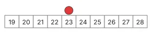

**3.** *Player 2 (child)* — Build the number with Numicon Shapes. Try to use as few Shapes as possible. Write the number next to the Shapes.
- **Child:** "I can make 23 with 2 tens and a 3."

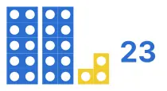

**4.** *Both players* — Repeat, but swap roles so Player 2 chooses the number.

> 🐰 **My goal:** I will be able to build, say and write all the numbers up to 30.

> 💡 **Try this!** Play in reverse. Player 1 builds a number, for example 16, with a 10-shape and a 6-shape, and says the number out loud. Player 2 writes 16, finds the number on the track and places the peg on 16.

> **Key activity — repeat often** (marked with a star in the book).

[↑ Contents](#contents)

---

## Odd and even

### Is it odd or even?

**Words to use:** pattern, build, even, odd

> **Guidance:** Look at how the holes are set out on each Numicon Shape. Those are the Numicon Shape patterns you will make.

**You need:** Numicon Shapes, a pile of 10 items (for example, buttons, dry pasta or the Numicon pegs).

**1.** *Player 1 (adult)* — Pick up some items from the pile.

**2.** *Player 1 (adult)* — Make a Numicon pattern with the items. Start at the bottom.

**3.** Ask:
- **Child:** "Is it odd or even?"
- **Adult:** "It's odd."
- **Child:** "How many items do you have? Can you find the Shape to match?"
- **Adult:** "7!"

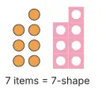

**4.** Play again, but now Player 2 starts. Keep taking turns and play this a lot.

> 💡 **Try this!** Try using a mix of different items. This shows that 7 of anything is still 7, even when the items are different. Once you get really good at this, you can try using between 10 and 20 items.

> 🐰 **My goal:** I will get to know which patterns of the Numicon Shapes are odd and which are even.

> **Key activity — repeat often** (marked with a star in the book).

[↑ Contents](#contents)

### Odd and even detectives

**Words to use:** odd, even

**You need:** Crayons, three or four different Numicon Shapes (each one wrapped in foil, put in an envelope or covered with a piece of paper), pegs, baseboard.

**1.** *Player 1 (child)* — Take one of the Numicon Shapes you have hidden in foil or paper. Feel it. If it is in paper, rub it with a crayon if you have one.

**2.** Ask:
- **Adult:** "Which Shape is it?"
- **Child:** "I think it is 6."
- **Adult:** "Is it odd or even? How do you know?"
- **Child:** "It is even. It doesn't have a sticking-up bit."

**3.** *Player 1 (child)* — Build the pattern with pegs on the baseboard to show what Shape you think it is.

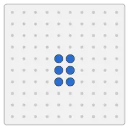

**4.** *Player 1 (child)* — Take out the hidden Shape and put it on top of the pegs. If it fits, you were correct! Play again, but this time Player 2 starts.

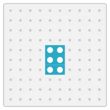

> 🐰 **My goal:** I will get to know the patterns for odd and even numbers.

[↑ Contents](#contents)

---

## Adding and subtracting

### Pairs to and within 10

**Words to use:** add, together, make, pair, number facts, stack, smallest, largest, odd, even, double

> **Guidance:** When you have done this activity a few times you may see a pattern. You can make 10 or the other totals by putting the first and last Shapes in the staircase together each time (for example, 9 and 1, then 8 and 2, and so on).

**You need:** Numicon Shapes, paper and pencil.

**1.** *Both players* — Put the Numicon Shapes 1–10 into the staircase pattern. Then move the 10-shape, so it is above the other Shapes, like this.

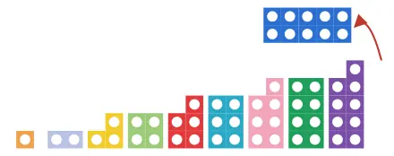

**2.** *Both players* — Pick two Shapes you can add together to make 10. Put them on top of the 10-shape. Do this as many times as you can.
- **Adult:** "I started with the smallest and largest numbers, 1 and 9."
- **Adult:** "Why is the 5-shape left at the end?"
- **Child:** "To make 10, you would need another 5-shape."

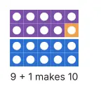

**3.** *Both players* — Separate the pairs (number facts) and move the Shapes back into the staircase pattern again. Write down each number fact of 10 as you do so.

```
1 + 9
2 + 8
3 + 7
```

**4.** *Both players* — Repeat the activity but find the pairs of numbers that make 9, not 10. Then find the pairs of numbers to make 8, then 7 and so on. Are there any Shapes left over each time?

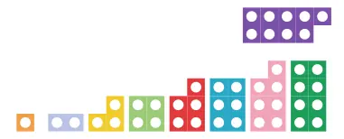

> 🐰 **My goal:** I will get to know all the pairs of number facts to and within 10!

*Answers: see [Answers](#answers).*

> **Key activity — repeat often** (marked with a star in the book).

[↑ Contents](#contents)

### What's my number?

**Words to use:** more, less, before, after, build, spin, add, take away

**You need:** Cut-out numeral cards 1–30, spinner with +1/−1 overlay, Numicon Shapes.

**1.** *Player 1 (adult)* — Shuffle the numeral cards and place them face down on the table. Take a card from the top of the pile without letting your partner see it. Spin the spinner to see if you should add or take away.
- **Adult** *(thinks)*: "I got 23 and I need to take away 1."

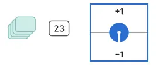

**2.** *Player 1 (adult)* — Use Numicon Shapes to build the answer.
- **Adult:** "I've taken away 1. What's the number on my card?"

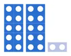

**3.** *Player 2 (child)* — Say the number you think is on your partner's card.
- **Child:** "You took away 1, so I will add 1 to find your number. Is it 23?"
- **Child:** "22 add 1 is 23, so 23 take away 1 is 22."

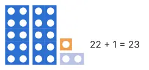

**4.** *Both players* — Check the card to see if you are right. Swap roles and play again.

> 🐰 **My goal:** I will be able to find 1 more and 1 less than a number.

[↑ Contents](#contents)

### 10 more/10 less

**Words to use:** build, spin, more, less, add, take away, total, tens, ones

> **Guidance:** After playing this many times, your child will start to see that the tens number goes up or down when you add or take away 10, but the ones number stays the same.

**You need:** Cut-out numeral cards 10–30, Numicon Shapes, spinner with +10/−10 overlay.

**1.** *Both players* — Shuffle the numeral cards and place them face down on the table next to the spinner.

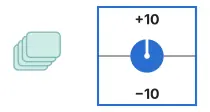

**2.** *Player 2 (child)* — Take a card and build the number with the Numicon Shapes.
- **Child:** "I put tens on the left and ones on the right."

**3.** *Player 1 (adult)* — Spin the spinner and add or take away 10. Show the answer with the Shapes.
- **Adult:** "I added 10 to 24. In total it makes 34."

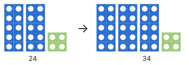

**4.** *Both players* — Do you both agree that the answer is correct? Swap roles and play again.

> 🐰 **My goal:** I will be able to use Numicon Shapes to answer 10 more and 10 less questions for numbers to 30.

[↑ Contents](#contents)

### Pairs to 20

**Words to use:** make, add, ten, pair, number facts, opposite

> **Guidance:** Look at the number facts you can both see each time. If you can see 3 + 7 = 10, then you can also see 7 + 3 = 10. Or if you see 15 + 5 = 20, then you can also see 5 + 15 = 20!

**You need:** Numicon Shapes.

**1.** *Both players* — Sit opposite each other. One of you builds a 1–9 staircase pattern and the other a 1–10 pattern, so that they look like this.

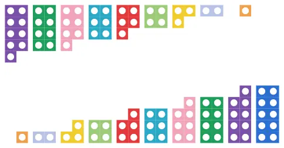

**2.** Push your staircases together so they make a rectangle of ten 10-patterns.
- **Adult:** "What pairs can you see?"
- **Adult:** "I can see that 4 add 6 makes 10."
- **Child:** "I can see that 6 add 4 makes 10!"

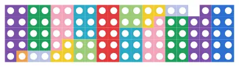

**3.** Separate out the staircases. Add a 10-shape beneath each number in the 1–10 staircase to make an 11–20 staircase. Then put the staircases back together.
- **Adult:** "What pairs to 20 can you see?"
- **Adult:** "I can see that 9 add 11 makes 20."
- **Child:** "I can see that 11 add 9 makes 20!"

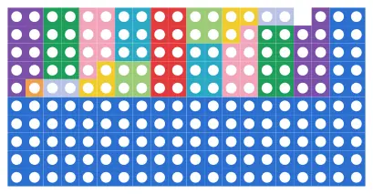

**4.** *Both players* — Move the 10-shapes to the other side and repeat. Can you say all of the pairs of numbers that make 20?

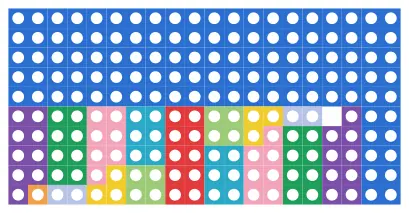

> 🐰 **My goal:** I will get to know the pairs of numbers that make 20.

*Answers: see [Answers](#answers).*

[↑ Contents](#contents)

### Race to 40

**Words to use:** spin, move, number, add, take away, forwards, backwards

> **Guidance:** If the number you spin takes you off the track, go back to the start. It may help to ask your child to show the number they are adding or taking away with their fingers, for example showing 5 fingers when they need to take away 5, and lowering each finger in turn as they count off their moves.

**You need:** Number track 1–40, two different coloured pegs, spinner with +3, 4, 7, 8 and −2, 5 overlay.

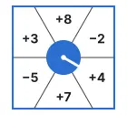

**1.** *Both players* — Take a peg each. Lay out the number track to 40. Put your pegs on 10.

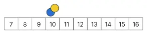

**2.** *Player 1 (adult)* — Spin the spinner and move your peg to add or take away the number shown. Count out loud as you move forwards or backwards along the track.
- **Adult:** "Add 4. I'm on 10, so 11, 12, 13, 14. I've moved my peg forwards 4."

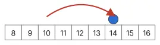

**3.** *Player 2 (child)* — Now Player 2 takes a turn.
- **Child:** "Take away 2. I start on 10, so 9, 8. I moved my peg backwards 2."

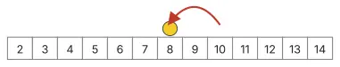

**4.** *Both players* — Keep taking turns. The winner is the first player to reach or go past 40.
- **Child:** "I got to 40! I won!"

> 🐰 **My goal:** I will practise adding 3, 4, 7 and 8 and subtracting 2 and 5 to or from numbers within 40.

[↑ Contents](#contents)

### Spin to add or take away

**Words to use:** add, take away, build, equals, tens, ones, numbers, how many more? how many less?

> **Guidance:** You can put Numicon Shapes along the number line to help you add. If you need to take away, you can put the Numicon Shape you are taking away above the line to help find the answer.

**You need:** Numicon Shapes, spinner with +/− overlay, cut-out 10–89 numeral cards (shuffled and placed face down), 10s number line, paper and pencil.

**1.** *Player 1 (adult)* — Turn over the top numeral card and build the number with Numicon Shapes on the 10s number line.

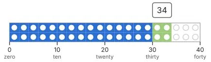

**2.** *Player 2 (child)* — Choose a Numicon Shape and spin the spinner to find out whether to add or take away that number.

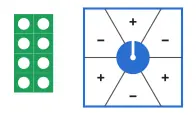

**3.** *Player 1 (adult)* — Add or take away the number. When adding, just add your Shape to the line. When taking away, you can place your Shape on top. Write and say the calculation.
- `34 − 8 = 26`
- **Adult:** "34 take away 8 equals 26."

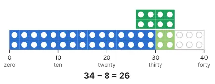

**4.** *Both players* — Repeat this often, adding or taking away different numbers.

> 💡 **Try this!** Challenge yourself to take away a 2-digit number.

> 🐰 **My goal:** I will be able to add and subtract on the 10s number line.

> **Key activity — repeat often** (marked with a star in the book).

[↑ Contents](#contents)

---

## Doubles and halves

### Spin a double or half!

**Words to use:** double, half, spin

**You need:** Numicon Shapes, cut-out 1–10 numeral cards, spinner with double/half overlay, paper and paint (for Try this!).

**1.** *Player 1 (adult)* — Place the numeral cards face down in two rows.

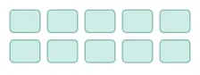

**2.** *Player 2 (child)* — Turn over a card and find the matching Numicon Shape. Spin the spinner to see if you need to double or halve the number.
- **Child:** "I need to find half of 8."

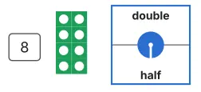

**3.** *Player 2 (child)* — Find the Shape that doubles or halves your number.
- **Child:** "Half of 8 is 4."

If you can't find a Shape to show half your number, you miss this turn.

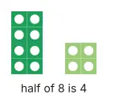

**4.** *Both players* — Swap roles and play again.

> 💡 **Try this!** Have fun printing double and half patterns by dipping Shapes in paint!
>
> 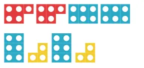

> 🐰 **My goal:** I will get to know doubles and halves of numbers to 10.

[↑ Contents](#contents)

---

## Numbers to 100

### Building numbers to 100

**Words to use:** count, build, place value

> **Guidance:** Place value is the value of each digit in a number. For example, in the number 37, the value of the digit 3 is 3 tens and the value of the 7 is 7 ones.

**You need:** Cut-out 0–100 numeral cards, Numicon Shapes, paper, a pen or pencil.

**1.** *Player 1 (child)* — Shuffle the numeral cards and place them face down next to the Numicon Shapes. Pick up a card and say the number.
- **Child:** "Thirty-seven."

**2.** *Player 2 (adult)* — Build the number with Numicon Shapes and write the number next to it.
- **Adult:** "I've used three 10-shapes and a 7-shape. I've built 37."

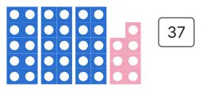

**3.** *Both players* — Swap roles and play again. Repeat this activity often.

> 🐰 **My goal:** I will be able to read, write and build numbers to 100 with Numicon Shapes.

> 💡 **Try this!** Look for opportunities to practise counting to 100 out loud, for example, counting while someone else brushes their teeth or counting the items on a shopping list. ("98 … 99 … 100!")
> Say a number between 0 and 100 and ask your partner to write it down.

> **Key activity — repeat often** (marked with a star in the book).

[↑ Contents](#contents)

### Partitioning

**Words to use:** say, build, digit, tens, ones, hundreds, place value, column, partition

> **Guidance:** To 'partition' means to break up a number. In this activity we are partitioning numbers into tens and ones.

**You need:** Numicon Shapes, cut-out 0–99 numeral cards, Tens and Ones (TO) place value frame, Hundreds, Tens and Ones (HTO) place value frame (for Try this!).

**1.** *Player 1 (child)* — Shuffle the numeral cards and place them face down next to the Numicon Shapes and the TO place value frame.

**2.** *Player 1 (child)* — Turn over a card, say the number and build it with Numicon Shapes.
- **Child:** "Sixty-five."

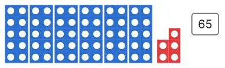

**3.** *Player 1 (child)* — Partition the number into tens and ones and put the Shapes on the TO place value frame. Say how many tens there are and how many ones.
- **Child:** "65 is 6 tens and 5 ones."

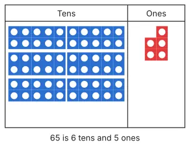

**4.** *Both players* — Swap roles and repeat. Practise this often.

> 💡 **Try this!** Can you make 100 in the HTO place value frame? How many 10s should you put in the Hundreds column?

> 🐰 **My goal:** I will be able to say, build and partition 2-digit numbers.

> **Key activity — repeat often** (marked with a star in the book).

[↑ Contents](#contents)

---

## Multiplying

### Counting in twos, fives and tens

**Words to use:** count, steps, twos, fives, tens

> **Guidance:** Here, patterns are started using pegs. To fit two pegs on one square put one on top of the other using a 1-shape in the middle to join them. When you run out of pegs continue the patten by saying the numbers. If it helps you can use buttons or other small objects to continue the patterns.

**You need:** Pegs, 1-shapes, number track 1–100. Lay out the track to make a number square, like in the pictures here but up to 100.

**1.** *Both players* — Lay out the number tracks like this, but go right up to 100. Collect six red, six blue and six yellow pegs.

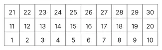

**2.** *Player 1 (adult)* — Count in twos, placing red pegs on the track as you go. Continue saying the pattern, counting in twos.
- **Adult:** "14, 16, 18, 20, …"

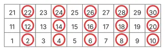

**3.** *Player 2 (child)* — Place blue pegs on the track as you count in fives. Can you carry on the pattern, counting in fives?

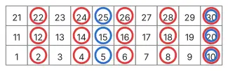

**4.** *Both players* — Place yellow pegs as you count in tens. Can you carry on the pattern, counting in tens?


> 💡 **Try this!** Can you work out which numbers would have three different-coloured pegs on them?

> 🐰 **My goal:** I will be able to count in steps of 2, 5 and 10 using a number track and spot the patterns this makes!

*Answers: see [Answers](#answers).*

> **Key activity — repeat often** (marked with a star in the book).

[↑ Contents](#contents)

### Lots of

**Words to use:** number, times, lots of

**You need:** Numicon Shapes, 10s number line.

**1.** *Both players* — Collect together the 1s, 2s, 3s, 5s and 10-shapes and put them in piles next to the 10s number line.


**2.** *Player 1 (adult)* — Pick up a handful of Shapes from one of the piles, counting them as you lay them on the 10s number line. Say: '___ lots of ___ makes ___'.
- **Adult:** "1, 2, 3, 4. Four lots of 10 makes 40."


**3.** *Player 2 (child)* — Remove Player 1's Shapes and pick up a handful of your own Shapes. Count them and place them on the number line.
- **Child:** "Three lots of 3 makes 9."
- **Child:** "If you want to try with more Shapes, use the link on the back of this book to the cut-out Shapes."


**4.** *Both players* — Repeat the activity, taking turns to choose Shapes from a different pile.

> 💡 **Try this!** Repeat the activity, but instead of saying 'lots of', say 'times', for example, I pick up two 5-shapes and say '2 times 5 makes 10'. You can also try writing this down as 2 × 5 = 10.

> 🐰 **My goal:** I will be able to answer 'How many lots of ___ make ___' questions.

[↑ Contents](#contents)

---

## Dividing

### How many __ in __?

**Words to use:** how many __ in __? groups, lots

**You need:** Cut-out 'How many __ in __?' question cards, Numicon Shapes, paper, a pen or pencil.

**1.** *Player 1 (adult)* — Place the cut-out questions face down in a pile. Turn over a question card.

**2.** *Player 1 (adult)* — Put Numicon Shapes together or draw around the Shapes until you get to the total on the card. Say the answer.
- **Adult:** "1, 2, 3, 4, 5, 6. There are six 2s in 12."


**3.** *Player 2 (child)* — Swap roles. Turn over a different card and take a turn.
- **Child:** "There are five 5s in 25."


**4.** *Both players* — Take turns to play until all the cards have been used. Repeat this often.

> 🐰 **My goal:** I will be able to answer 'How many __ in __?' questions.

*Answers: see [Answers](#answers).*

> **Key activity — repeat often** (marked with a star in the book).

[↑ Contents](#contents)

### Dividing by 2, 5 and 10

**Words to use:** divide, lots of, groups, how many? multiples, parts, twos, fives, tens

> **Guidance:** Dividing by 2 is the same as finding a half.

**You need:** Numicon Shapes, spinner with a 2/5/10 overlay, cut-out multiples of 10 numeral cards (10, 20, 30, 40, 50, 60, 70, 80, 90, 100), paper and pencil.

**1.** *Player 1 (adult)* — Shuffle the cards and place them face down next to the spinner.


**2.** *Player 1 (adult)* — Turn over the top card and make the number with Numicon Shapes. Spin the spinner to see whether you need to divide by 2, 5 or 10.


**3.** *Player 1 (adult)* — You can use Numicon Shapes to help you divide your number into 2, 5 or 10 parts. How much do you have in each part? Write the answer.
- **Adult:** "I need to find the answer to 30 divided by 2. If I break 30 into 2 parts, how much is in each part?"
- **Child:** "It's 15!"
- `30 ÷ 2 = 15`


**4.** *Both players* — Swap roles and play again. Can multiples of 10 always be divided by 2, 5 and 10?

> 🐰 **My goal:** I will be able to divide by 2, 5 and 10.

*Answers: see [Answers](#answers).*

[↑ Contents](#contents)

---

## Fractions

### Fold the Shape

**Words to use:** half, quarter, whole, how many? fold, check

**You need:** Numicon Shapes, spinner with ½/¼ overlay, pencil, scissors, paper (or printable Numicon Shapes you can download and cut out using the link at the back of this book).

**1.** *Both players* — Each of you draw around a 4-shape and cut it out. Remember to draw the holes.

**2.** *Player 1 (adult)* — Spin the spinner to see if you need to find ½ or ¼ of 4. Fold your Shape into 2 pieces to show ½, or into 4 to show ¼. Say the answer as 'Half of __ is __', or 'A quarter of __ is __'.
- **Adult:** "Half of 4 is 2."


**3.** *Player 2 (child)* — Spin the spinner and take your turn.
- **Child:** "A quarter of 4 is 1."


**4.** *Both players* — Repeat to find ½ or ¼ of 8, 12, 16 and 20. Put Shapes together to form these numbers and draw around them.


> 💡 **Try this!** Look for halves and quarters around the home. Can you cut a pizza into quarters?

> 🐰 **My goal:** I will be able to find halves and quarters.

[↑ Contents](#contents)

### Build a whole!

**Words to use:** number, times, half of, quarter of

> **Guidance:** Place pegs on the Shape to show one quarter or one half, depending on what you spin.

**You need:** Even Numicon Shapes, pegs, spinner with ½ / ¼ overlay.

**1.** *Both players* — Collect an 8-shape each and some pegs. You are going to race to fill your Shape.

**2.** *Player 1 (adult)* — Spin the spinner and place pegs on the Shape to show the fraction. For half of 8, use 4 pegs. For a quarter of 8, use 2 pegs.
- **Adult:** "A quarter of 8 is 2."

 

**3.** *Player 2 (child)* — Spin and take your turn.
- **Child:** "I can fill in 4 pegs. Half of 8 is 4."


**4.** *Both players* — Keep taking turns to spin half or a quarter of 8 until you fill your Shape. If you spin more than you need, you miss a turn. The first person to fill their Shape wins!

> 💡 **Try this!** Repeat with Shapes for 4, 12, 16, 20.

> 🐰 **My goal:** I will be able to make a whole with quarters and halves!

*For more online, see the back cover!*

[↑ Contents](#contents)

---

## Answers

### Page 9 · Growing and shrinking patterns

Here are some possible answers but your child may have made other patterns too. The patterns can be continued as far as you like, either using the Shapes or by drawing them.

**1.** This pattern grows by 1 each time.


**2.** This pattern shrinks by 2 each time.


**3.** This pattern grows by 9, then shrinks by 9, then grows by 9, then shrinks by 9, and so on.


### Page 16 · Pairs to and within 10

Help your child to see that it doesn't matter which order you add the pairs of numbers in, you still get the same answer: 1 + 9 makes 10 and so does 9 + 1.

| Total | Facts | Extra pairs |
|---|---|---|
| **10** | 1 + 9, 2 + 8, 3 + 7, 4 + 6, (5 left on its own) | 0 + 10, 5 + 5 |
| **9** | 1 + 8, 2 + 7, 3 + 6, 4 + 5 | 0 + 9 |
| **8** | 1 + 7, 2 + 6, 3 + 5, (4 left on its own) | 0 + 8, 4 + 4 |
| **7** | 1 + 6, 2 + 5, 3 + 4 | 0 + 7 |
| **6** | 1 + 5, 2 + 4, (3 left on its own) | 0 + 6, 3 + 3 |
| **5** | 1 + 4, 2 + 3 | 0 + 5 |
| **4** | 1 + 3 (2 left on its own) | 0 + 4, 2 + 2 |
| **3** | 1 + 2 | 0 + 3 |

You can extend this activity by finding any other pairs of numbers that make each total. These are shown as *extra pairs* above. Zero can be added to any number to make another pair of facts. You'll see every even number has a piece left on its own. Just double that left-over piece and you'll find another pair of numbers to make the total. Odd numbers don't have a pair of doubles to make the total, so there's no left over piece.

### Page 19 · Pairs to 20

```
10 + 10 = 20
11 + 9 = 20  or  9 + 11 = 20
12 + 8 = 20  or  8 + 12 = 20
13 + 7 = 20  or  7 + 13 = 20
14 + 6 = 20  or  6 + 14 = 20
15 + 5 = 20  or  5 + 15 = 20
16 + 4 = 20  or  4 + 16 = 20
17 + 3 = 20  or  3 + 17 = 20
18 + 2 = 20  or  2 + 18 = 20
19 + 1 = 20  or  1 + 19 = 20
20 + 0 = 20  or  0 + 20 = 20
```

### Page 25 · Try this!

The multiples of 10.

### Page 27 · How many __ in __?

| | | | |
|---|---|---|---|
| **1.** 5 | **2.** 6 | **3.** 7 | **4.** 9 |
| **5.** 6 | **6.** 6 | **7.** 10 | **8.** 5 |
| **9.** 9 | **10.** 4 | **11.** 6 | **12.** 9 |

*(The numbers refer to the cut-out question cards.)*

### Page 28 · Dividing by 2, 5 and 10

It is true that 2, 5 and 10 always do divide exactly into any tens number.

| Number card | ÷ 2 | ÷ 5 | ÷ 10 |
|---|---|---|---|
| 10 | = 5 | = 2 | = 1 |
| 20 | = 10 | = 4 | = 2 |
| 30 | = 15 | = 6 | = 3 |
| 40 | = 20 | = 8 | = 4 |
| 50 | = 25 | = 10 | = 5 |
| 60 | = 30 | = 12 | = 6 |
| 70 | = 35 | = 14 | = 7 |
| 80 | = 40 | = 16 | = 8 |
| 90 | = 45 | = 18 | = 9 |
| 100 | = 50 | = 20 | = 10 |

[↑ Contents](#contents)

---

## What next?

There's no end to the activities, games and enjoyment you can have with Numicon. It gives rich learning and fun challenges for children of any age – and adults too!

**Giving you more**
To thank you for choosing this kit and to support you and your child further, we've provided bonus resources for you online. Simply use the QR code or the link below to access these.

We'll continue to add to this collection, so you'll find everything listed here and more!
- Bonus activities and games to go with your kit
- Support videos and guidance
- Extra copies of the cut-out cards
- Printable Numicon Shapes
- Blank spinner overlays to design your own games

Online: [Oxford Owl — Numicon at Home kits](https://home.oxfordowl.co.uk/maths/numicon-at-home-kits/)

Join our Numicon Facebook community for further support.

[↑ Contents](#contents)
